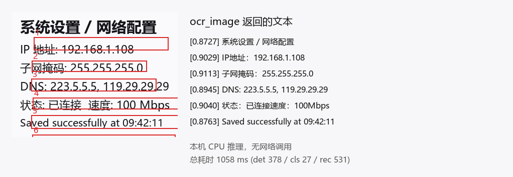

# dsh-rapidocr

**Local, offline OCR for [DeepSeek Harness](https://github.com/deepseek-ai/deepseek-harness).**

A text-only model cannot look at an image. When a user attaches a screenshot to a
conversation, the agent is told the file path but never sees the pixels.
`dsh-rapidocr` closes that gap **on this machine**: the host reads the image
bytes, hands them to a bundled CPU OCR engine and returns plain text.

- **Private** — images never leave the computer. No network call at all.
- **Cheap** — no vision-model tokens, no API bill.
- **Offline** — the 13 MB of ONNX weights ship inside the plugin.
- **Fast** — a 1280×720 screen capture is recognised in roughly half a second on
  an ordinary 8-core desktop CPU.

```
agent ──▶ ocr_image(file_path) ──▶ DSH Host (index.js)
                                    │  path authorised by ctx.fs, bytes read there
                                    ▼
                                  sidecar worker (worker/ocr-worker.js)
                                    │  one warm ONNX engine, JSON Lines protocol
                                    ▼
                                  RapidOCR pipeline (src/) ──▶ ONNX Runtime (CPU)
```

The engine lives in a **separate Node process**, so a one-second inference never
blocks the Electron UI. It is started lazily on the first call and stays warm,
so the ~410 ms model load is paid once rather than per image.

## Install

**Option A — Plugin market.** Once the plugin is listed in the
[dsh-plugin-index](https://github.com/polang233/dsh-plugin-index) market, open
DSH → *Plugins* → *Market* and install **Local OCR (dsh-rapidocr)**.

**Option B — from a clone of this repository.** Add the package to your DSH
profile and enable the bundle:

```powershell
# 1. clone
git clone https://github.com/Timqt/dsh-rapidocr.git

# 2. point your profile at it
#    %USERPROFILE%\.dsh\profiles\<profile>\package.json
{
  "dependencies": {
    "@local/dsh-rapidocr": "link:D:/path/to/dsh-rapidocr/packages/dsh-rapidocr"
  },
  "dsh": { "profile": { "bundles": [ ..., "@local/dsh-rapidocr" ] } }
}
```

Restart DSH (or let the profile watcher pick the change up). The plugin then
appears under *Settings → Plugins* with an editable configuration row.

## Use

The agent calls the tool for you; you can also drive it directly:

```jsonc
// ocr_image takes a file path, exactly like the built-in read_image tool
{ "file_path": "C:\\Users\\me\\Desktop\\screenshot.png" }
```

```text
系统设置／网络配置
IP地址：192.168.1.108
子网掩码：255.255.255.0
DNS: 223.5.5.5, 119.29.29.29
状态：已连接 速度：100Mbps
```



## Platform support

**Windows x64 only in this release.** The bundled ONNX Runtime ships as a
prebuilt `onnxruntime.dll` for `win32/x64`; the OpenCV.js part is WASM and is
platform-neutral, but the inference backend is not. On other platforms the
plugin installs but the engine fails to load — add the matching
`onnxruntime-node` binary for your platform to `vendor/node_modules/` (or
publish a per-platform build) to run it there.

## What it recognises

| Input | Result |
|---|---|
| PNG (all colour types, incl. palette / RGBA), JPEG (baseline + progressive) | up to 52 MB and 40 megapixels per image |
| Chinese, English, digits, common punctuation | 6623-character dictionary |
| 180°-rotated text | corrected automatically |
| Printed text | yes |
| Handwriting, photos of text at a strong angle | no |
| Image *content* (what is in the picture, tables, charts) | no — this is OCR, not a vision model |

## Performance

Measured on an Intel i7-10700F (8 cores / 16 threads, no GPU):

| Image | Warm latency | det / cls / rec |
|---|---|---|
| 1280×720 screenshot | 495 ms | 134 / 4 / 275 ms |
| 800×600 mixed text | 568 ms | 118 / 16 / 413 ms |
| 1920×1080 dense text | 1068 ms | 375 / 7 / 563 ms |
| A4 300 dpi scan (68 lines) | 9.3 s | 3058 / 52 / 10507 ms |

Cost scales with the number of text lines — roughly 120–210 ms per line, and it
is **15–25 % faster than the Python reference implementation** of RapidOCR on the
same machine.

## Repository layout

```
packages/dsh-rapidocr/   the publishable plugin bundle
  index.js               Host plugin: tool registration, sidecar lifecycle
  worker/ocr-worker.js   Sidecar: JSON Lines protocol over stdin/stdout
  worker/selftest.js     Sidecar smoke test (real child process, real protocol)
  src/                   The RapidOCR pipeline port (det / cls / rec / geometry)
  models/                PP-OCRv3 ONNX weights (13.07 MB)
  vendor/                Vendored runtime dependencies (no npm install needed)
  locale/, icon.svg      Display metadata
bench/                   Benchmark harness, reference images and baselines
docs/                    Evaluation, implementation record and DSH API evidence
```

The bundle has **zero npm dependencies, zero build scripts and zero install
approvals**: every runtime dependency is vendored under `vendor/`, and the
plugin manager can therefore install it without a package manager ever running
a postinstall hook.

## Documentation

| Document | Contents |
|---|---|
| [docs/evaluation.md](docs/evaluation.md) | Why this plugin, the measured numbers, the architecture comparison and the capability boundaries |
| [docs/implementation.md](docs/implementation.md) | What was actually built, the sidecar protocol, the pitfalls hit on the way, and the remaining known gaps |
| [docs/dsh-integration.md](docs/dsh-integration.md) | Evidence for the DSH plugin API (file and line references into the host) |
| [packages/dsh-rapidocr/README.md](packages/dsh-rapidocr/README.md) | The plugin's own manual: configuration, testing, layout |

## Credits

The OCR pipeline in `src/` is a port of
[RapidOCR](https://github.com/RapidAI/RapidOCR) (PP-OCRv3: DBNet detection,
direction classification, CRNN recognition with CTC decoding), and the ONNX
weights are the Apache-2.0 PP-OCRv3 models. See
[NOTICE](packages/dsh-rapidocr/NOTICE) for the full third-party attribution.

## License

Apache-2.0 — see [LICENSE](LICENSE).

[](https://github.com/deepseek-ai/deepseek-harness)
